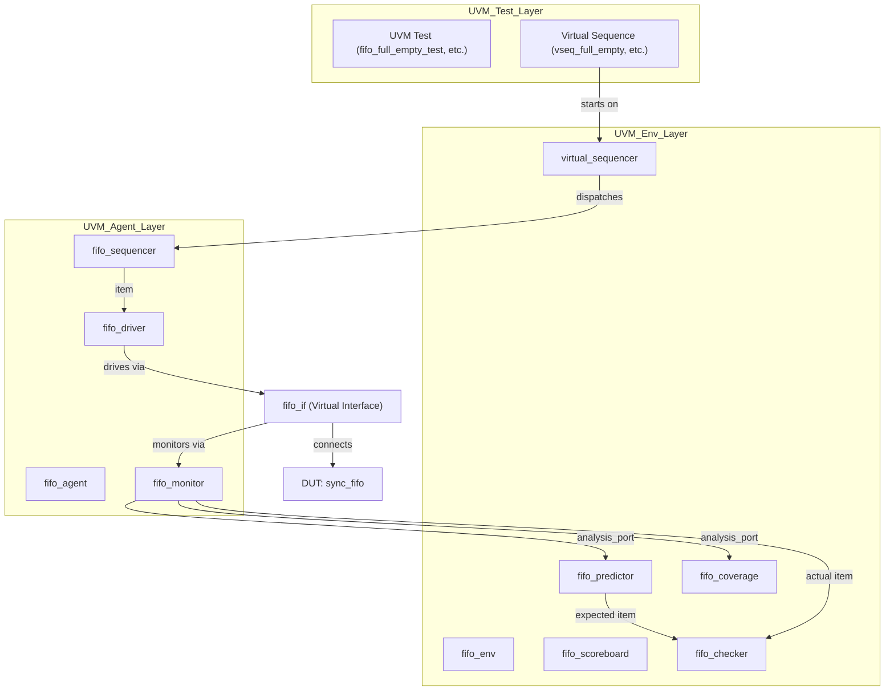

# Parameterized Synchronous FIFO Verification with UVM 1.2


본 프로젝트는 파라미터화 가능한 **Synchronous FIFO IP**의 기능 검증을 위한 **UVM (Universal Verification Methodology) 기반 산출물 포트폴리오**입니다. 
단순 검증에 그치지 않고, **Verification Plan(vPlan) 수립**, **개별 UVM Test Case 모듈화**, **Virtual Sequence 기반 검증**, **Scoreboard 데이터 무결성 검증**, **Coverage 수집 및 Regression 자동화**를 완비하였습니다.

---

## 1. DUT (Design Under Test) 명세

### 1.1 모듈 개요
- **Module Name**: `sync_fifo` ([sync_fifo.sv](file:///home/rocket/workspaces/hdl_workspace/common/ip/sync_fifo/rtl/sync_fifo.sv))
- **Interface**: `fifo_if` ([fifo_if.sv](file:///home/rocket/workspaces/hdl_workspace/common/ip/sync_fifo/rtl/fifo_if.sv))
- **Key Features**: 
  - 가변 데이터 폭(`WIDTH_DATA`) 및 깊이(`DEPTH_FIFO`) 지원.
  - Phase Wrap-around 기반 포인터 관리를 통한 Full/Empty 정확 감지.
  - Full 상태 추가 Write 시 Drop(오버라이트 방지) & Empty 상태 추가 Read 시 Drop (Underrun 방지).

### 1.2 파라미터 및 인터페이스 신호

| Parameter / Signal | Direction | Width | Description |
| :--- | :--- | :--- | :--- |
| `WIDTH_DATA` | Parameter | int (Default: 8) | FIFO 데이터 버스 비트 폭 |
| `DEPTH_FIFO` | Parameter | int (Default: 16) | FIFO 깊이 (최대 저장 데이터 개수) |
| `clk` | Input | 1 bit | 시스템 클록 |
| `rstn` | Input | 1 bit | Active-Low 비동기/동기 리셋 |
| `cmd_push` | Input | 1 bit | 쓰기 요청 신호 |
| `cmd_pop` | Input | 1 bit | 읽기 요청 신호 |
| `data_push` | Input | `WIDTH_DATA` | 쓰기 데이터 버스 |
| `data_pop` | Output | `WIDTH_DATA` | 읽기 데이터 버스 |
| `flag_empty` | Output | 1 bit | FIFO 비어있음 플래그 |
| `flag_full` | Output | 1 bit | FIFO 가득 참 플래그 |

---

## 2. Verification Plan (vPlan)

| Feature ID | Feature Name | Description | Test Case Name | Sequence / Virtual Sequence | Pass / Fail Criteria | Target Coverage |
| :---: | :--- | :--- | :--- | :--- | :--- | :---: |
| **VP-01** | Basic Read/Write | 기본 단일 Write & Read 데이터 전달 | `fifo_base_test` | `virtual_sequence` | Data Match | 100% |
| **VP-02** | Full/Empty Boundary | FIFO를 꽉 채우고(Full) 완전히 비움(Empty) | `fifo_full_empty_test` | `vseq_full_empty` | Flag Match & Data Order | 100% |
| **VP-03** | Overflow Handling | Full 상태에서 추가 Push 시 데이터 유실/오버라이트 방지 | `fifo_overflow_test` | `vseq_overflow` | Data Drop & Flag Hold | 100% |
| **VP-04** | Underflow Handling | Empty 상태에서 추가 Pop 시 유효하지 않은 읽기 방지 | `fifo_underflow_test` | `vseq_underflow` | Data Drop & Flag Hold | 100% |
| **VP-05** | Simultaneous R/W | 읽기와 쓰기를 동일 클록 주기에 동시 수행 | `fifo_simultaneous_rw_test` | `vseq_simultaneous_rw` | Pointer Stability & Match | 100% |

---

## 3. UVM Verification Architecture



### 3.1 주요 컴포넌트 역할
- **`fifo_item`**: Push/Pop 명령, Write 데이터, Flag 상태를 추상화한 트랜잭션 클래스 ([fifo_item.sv](file:///home/rocket/workspaces/hdl_workspace/common/ip/sync_fifo/tb/uvm/src/agent/fifo_item.sv))
- **`fifo_driver`**: `fifo_item`을 받아 `fifo_if` 클록킹 블록(`cb`)에 맞춰 RTL 신호로 인가 ([fifo_driver.sv](file:///home/rocket/workspaces/hdl_workspace/common/ip/sync_fifo/tb/uvm/src/agent/fifo_driver.sv))
- **`fifo_monitor`**: Interface 버스를 핀 단위로 모니터링하여 `fifo_item` 형태로 변환 후 Analysis Port로 방송 ([fifo_monitor.sv](file:///home/rocket/workspaces/hdl_workspace/common/ip/sync_fifo/tb/uvm/src/agent/fifo_monitor.sv))
- **`fifo_predictor` & `fifo_checker`**: Gold Reference 모델 기반 예상값 생성 및 실제 DUT 데이터/플래그 무결성 자율 비교 ([fifo_checker.sv](file:///home/rocket/workspaces/hdl_workspace/common/ip/sync_fifo/tb/uvm/src/scoreboard/fifo_checker.sv))
- **`fifo_coverage`**: 동작(Read/Write/Idle/Simultaneous)과 상태(Full/Empty/Normal) 간 Cross Coverage 수집 ([fifo_coverage.sv](file:///home/rocket/workspaces/hdl_workspace/common/ip/sync_fifo/tb/uvm/src/agent/fifo_coverage.sv))

---

## 4. 디렉토리 구조

```text
sync_fifo/
├── .gitignore                    # 시뮬레이션 임시 파일 및 파형 파일 제외
├── Makefile                      # 빌드, 테스트 실행, 레그레션 자동화 Makefile
├── README.md                     # 프로젝트 검증 명세 및 문서
├── rtl/                          # RTL 소스 코드
│   ├── fifo_if.sv               # SystemVerilog Interface
│   └── sync_fifo.sv             # Synchronous FIFO DUT
└── tb/                           # 검증 환경
    ├── direct/                   # Direct SystemVerilog Testbench
    │   └── tb_sync_fifo.sv
    └── uvm/                      # UVM Testbench Environment
        ├── tb_sync_fifo_uvm.sv   # Top-level Testbench Module
        ├── sync_fifo_uvm_pkg.sv  # UVM Package
        ├── src/
        │   ├── agent/            # Agent, Driver, Monitor, Coverage, Item
        │   │   ├── fifo_item.sv
        │   │   ├── fifo_agent.sv
        │   │   ├── fifo_driver.sv
        │   │   ├── fifo_monitor.sv
        │   │   └── fifo_coverage.sv
        │   ├── env/              # Environment Component
        │   │   └── fifo_env.sv
        │   ├── scoreboard/       # Scoreboard, Predictor, Checker
        │   │   ├── fifo_predictor.sv
        │   │   ├── fifo_checker.sv
        │   │   └── fifo_scoreboard.sv
        │   └── seq/              # Sequences & Virtual Sequences
        │       ├── fifo_sequence_read.sv
        │       ├── fifo_sequence_write.sv
        │       ├── fifo_sequence_readXwrite.sv
        │       ├── fifo_sequence_reset.sv
        │       ├── virtual_sequencer.sv
        │       ├── vseq_full_empty.sv
        │       ├── vseq_overflow.sv
        │       ├── vseq_underflow.sv
        │       └── vseq_simultaneous_rw.sv
        └── tests/                # Modular UVM Test Cases
            ├── fifo_base_test.sv
            ├── fifo_full_empty_test.sv
            ├── fifo_overflow_test.sv
            ├── fifo_underflow_test.sv
            └── fifo_simultaneous_rw_test.sv
```

---

## 5. 실행 방법 (Usage Guide)

### 5.1 개별 UVM Test 실행
특정 검증 시나리오만 핀포인트로 실행하여 디버깅할 수 있습니다:

```bash
# 기본 UVM Test 실행
make uvm

# Full/Empty 경계 검증 Test 실행
make uvm TEST=fifo_full_empty_test

# Full 상태 Overflow 검증 Test 실행
make uvm TEST=fifo_overflow_test

# Empty 상태 Underflow 검증 Test 실행
make uvm TEST=fifo_underflow_test

# 동시 Read/Write 검증 Test 실행
make uvm TEST=fifo_simultaneous_rw_test
```

### 5.2 파형(Waveform) 확인
시뮬레이션 수행 후 생성된 `.vcd` 파형을 GTKWave로 즉시 확인합니다:

```bash
make uvm wave
```

### 5.3 전체 Regression 일괄 실행
등록된 모든 UVM Test Suite를 순차적으로 일괄 수행합니다:

```bash
make regression
```

---

## 6. 검증 결과 (Verification Results)

- **Data Integrity**: 모든 시나리오에서 `CHECKER_MATCH` 100% 달성 및 Data Mismatch 0건.
- **Corner Protection**: Full 상태 추가 Write 및 Empty 상태 추가 Read 발생 시 Scoreboard Drop 확인.
- **Functional Coverage**: 
  - Operations (`WRITE`, `READ`, `WR_RD`, `IDLE`) Coverage: **100%**
  - FIFO Status Flags (`EMPTY`, `FULL`, `NORMAL`) Coverage: **100%**
  - Cross Coverage (`Op vs Flag` Cross): **100%**
# syncfifo-design-verif-
